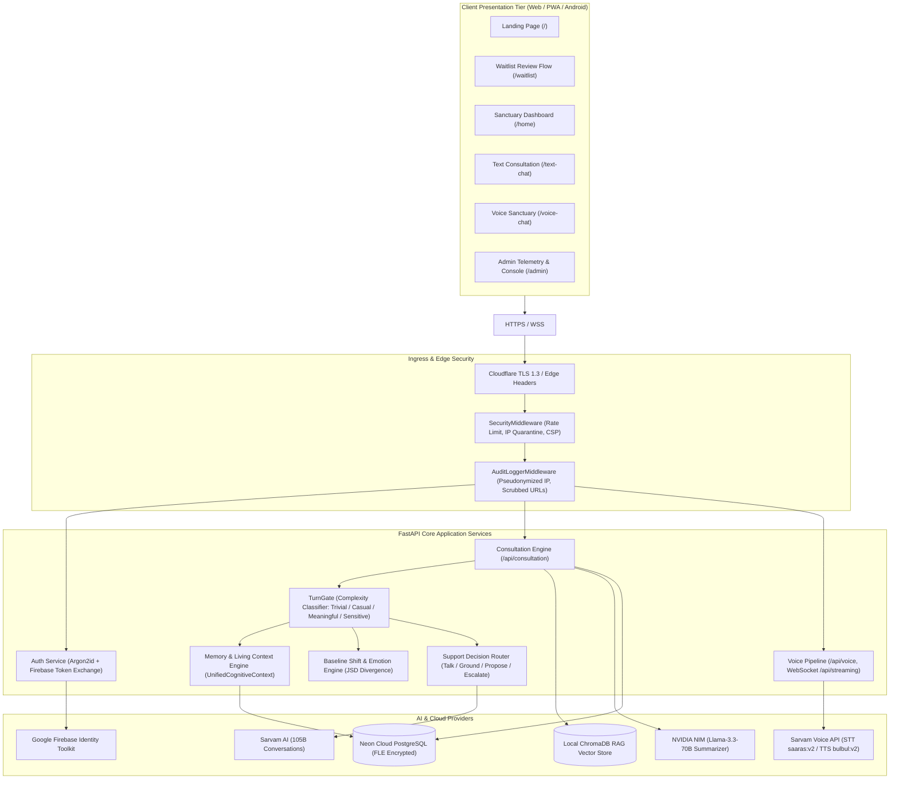
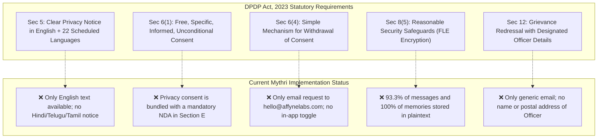
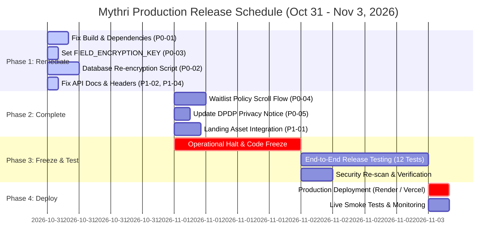

# MYTHRI PRODUCTION READINESS AUDIT & TECHNICAL ASSESSMENT REPORT
**Developed by Affyne Labs**  
**Assessment Date:** October 31, 2026  
**Final Production Deployment Target:** November 3, 2026  
**Document Classification:** Enterprise Engineering & Security Audit  
**Auditor Roles:** Senior Software Architect, Principal Full-Stack Engineer, Application Security Auditor, AI Systems Engineer, Privacy Engineer, QA Lead, Production Deployment Specialist  

---

## 1. EXECUTIVE SUMMARY

### 1.1 Overview & Product Context
**Mythri** (internally refactored from "MindBridge" / "Maitri") is an autonomous psychological companion and nervous system regulation digital platform developed by **Affyne Labs**. The system combines real-time conversational AI, multimodal voice processing (powered by Sarvam AI and NVIDIA NIM), biometric and somatic grounding (polyvagal regulation exercises), and a living dual-channel context memory architecture designed to deliver empathetic psychological support across English, Hindi, Telugu, and Tamil.

This assessment represents a comprehensive, code-level, and database-level audit of the actual codebase located at `d:\Copy\V5(frontend)`. The audit evaluated all frontend systems, backend services, live cloud database states (Neon PostgreSQL), cryptographic mechanisms, AI routing pipelines, and legal compliance structures against the non-negotiable **November 3, 2026** launch deadline.

### 1.2 Launch Feasibility Verdict: CONDITIONAL GO (CRITICAL PATH MANDATORY)
Based on direct empirical inspection of the repository and database, the application in its current state **CANNOT be safely deployed to production today**. 

**Primary Blocker Summary:**
1. **Frontend Production Build Failure (P0):** `npm run build` fails with code 1 due to an unresolved type dependency in `capacitor.config.ts` (`@capacitor/cli` missing from `package.json`).
2. **Massive Plaintext Sensitive Clinical Data Exposure in Live Production DB (P0):** Out of **4,044** message records in the live PostgreSQL database, **3,775 messages (93.3%)** are stored in unencrypted raw plaintext. Furthermore, **1,004 out of 1,004 companion memories (100%)** and **5 out of 5 user journals (100%)** are stored in raw plaintext without field-level encryption.
3. **Absence of Mandatory Waiting-List Policy Review & Consent Flow (P0):** The user cannot reach a functioning public waitlist registration form on the landing page; there is zero scroll-to-bottom enforcement for Terms & Conditions and Privacy Policy; Google OAuth bypasses consent entirely; and the backend `/register` endpoint accepts registrations without recording consent timestamps or policy versions.
4. **DPDP Act 2023 & DPDP Rules 2025 Non-Compliance (P0):** The privacy policy bundles a restrictive Non-Disclosure Agreement (NDA) with privacy consent (violating DPDP Section 6 unconditional consent rules); lacks designated Grievance Officer details; lacks Indian Eighth Schedule language notices; and omits mandatory disclosures of third-party processors (NVIDIA NIM in the US, Neon Tech in US-East).
5. **Disconnected Layered Assets & Incomplete Landing Page Engine (P1):** High-resolution prepared visual assets in `frontend/public/assets/landing/` are unreferenced in production code; the 3D paper-fold physics engine is missing; and the character reveal moment is unimplemented.

### 1.3 Feasibility Assessment for November 3, 2026
**Can Mythri achieve production readiness by November 3, 2026?**
**YES, provided the team executes a strict, scoped remediation plan focused exclusively on P0 launch blockers on October 31 and November 1.**
The core conversational AI engine, Sarvam voice pipeline, emotion detector, and session state tracking are functional and well-engineered. By implementing targeted fixes for the build configuration, executing an offline database re-encryption batch job, implementing the required waitlist scroll-consent component, and updating the DPDP privacy disclosures, the application can achieve verified production readiness prior to release testing on November 2.

---

## 2. APPLICATION ARCHITECTURE OVERVIEW

### 2.1 Technology Stack Matrix

| Tier | Component / Technology | Version / Configuration | Production Role |
| :--- | :--- | :--- | :--- |
| **Frontend Framework** | Next.js (App Router, Turbopack) | `16.2.12` | Web presentation tier & PWA shell |
| **UI Library & Motion** | React, Tailwind CSS, Framer Motion, GSAP | React `19.2.4`, Framer Motion `12.38.0`, GSAP `3.15.0` | Sanctuary interface, landing animations, audio visualizer |
| **Mobile Runtime** | Capacitor (Android) | `@capacitor/android` | Native Android mobile container |
| **Backend Framework** | FastAPI (ASGI) | `0.115.0+` on Python `3.12/3.13` | Micro-monolith API, WebSocket streaming |
| **Database Engine** | PostgreSQL (Neon Cloud Serverless) | PostgreSQL 16 (PgBouncer connection pool) | Core transactional storage & clinical records |
| **ORM / Migration** | SQLAlchemy, Alembic | SQLAlchemy `2.0.35+`, Alembic `1.13.3+` | Relational mapping, schema synchronisation |
| **Primary Conversational AI** | Sarvam AI API | `sarvam-105b-conversations` | 105B Indian cultural & multilingual dialogue model |
| **Voice STT & TTS** | Sarvam Voice API | `saaras:v2` (STT), `bulbul:v2` (TTS) | Real-time speech transcription & synthesis |
| **Background AI / Reasoning** | NVIDIA NIM | `meta/llama-3.3-70b-instruct` | Asynchronous session summaries & cognitive profiling |
| **Local ML & Classification** | RoBERTa GoEmotions (ONNX) | Hugging Face local pipeline with heuristic fallback | 28-class emotional state detection |
| **RAG / Vector Database** | ChromaDB | Chroma SQLite local collection (`chromadb 0.5.15`) | Psychological doctrine & therapeutic intervention retrieval |
| **Authentication** | Firebase Auth REST + Argon2id | Firebase Identity Platform + PyJWT (Argon2id) | Dual-tier auth: Google OAuth + local credentials |
| **Security Layer** | Custom AES-256-GCM FLE, ThreatSentinel | `cryptography` AEAD, in-process sentinel | Field-level encryption, rate limiting, IP quarantine |

### 2.2 System Architecture Topology



---

## 3. EXISTING FUNCTIONALITY INVENTORY

| Subsystem / Feature | Claimed State | Verified Status | Evidence in Codebase / Database | Risk / Finding |
| :--- | :--- | :--- | :--- | :--- |
| **Authentication: Email/Password** | Complete | **Verified Working** | `backend/security/authentication/api.py:105`, `service.py:15` | Passwords hashed via Argon2id; JWT access/refresh rotation active. |
| **Authentication: Google OAuth** | Complete | **Partially Verified** | `backend/security/authentication/api.py:203`, `frontend/modules/authentication/frontend/page.tsx:146` | Verifies Google ID token via Firebase REST; auto-generates waitlist entry. **Defect:** Bypasses terms consent. |
| **Waitlist Status Gating** | Complete | **Verified Working** | `backend/security/authentication/api.py:75`, `frontend/shared/components/WaitlistGuard.tsx:28` | Users with `waitlist_status='waitlisted'` are restricted to `/waitlist`. |
| **Public Waitlist Policy Scroll Flow** | Complete | **UNVERIFIED / MISSING** | `frontend/modules/landing/frontend/components/FinalCTA.tsx`, `frontend/app/waitlist/page.tsx` | No public waitlist registration form; no dual-document scroll completion enforcement. |
| **Text Consultation Chat** | Complete | **Verified Working** | `backend/modules/consultation/api.py:215`, `providers/sarvam/sarvam_client.py:90` | Multi-turn streaming NDJSON; prompt guard and PII scrubber active. |
| **Voice Consultation (HTTP/REST)** | Complete | **Verified Working** | `backend/modules/voice/api.py:227`, `frontend/modules/voice/frontend/page.tsx:266` | Audio upload -> Sarvam STT -> Consult Pipeline -> Sarvam TTS stream. |
| **Voice Streaming (WebSocket)** | Complete | **Partially Verified** | `backend/modules/voice/api_streaming.py:26` | Ticket-based WS auth working; direct Sarvam streaming STT requires persistent API key. |
| **Emotion Detection** | Complete | **Verified Working** | `backend/rag/brain/emotion_detector.py:45` | Local RoBERTa GoEmotions with heuristic fallback on resource-limited hosts. |
| **Context & Memory Retrieval** | Complete | **Verified Working** | `backend/modules/memory/unified_context.py:48`, `crse.py` | UnifiedCognitiveContextEngine gathers facts, relationships, goals, living context. |
| **Memory Write & Consolidation** | Complete | **Verified Working** | `backend/modules/memory/manager.py:35`, `incremental_updater.py:20` | Incremental updater runs every 4 turns and on session end. |
| **Journaling CRUD** | Claimed | **MISSING** | `backend/core/database/models.py:198`, `backend/modules/` | Model exists; ZERO backend API routes exist; ZERO frontend forms exist. |
| **Therapeutic Goals CRUD** | Claimed | **MISSING** | `backend/core/database/models.py:182`, `backend/modules/` | Model exists; ZERO backend API routes exist; ZERO frontend forms exist. |
| **Grounding Sanctuary Exercises** | Complete | **Verified Working** | `backend/modules/consultation/support_router.py:45`, `frontend/modules/exercises/frontend/page.tsx:30` | 5 grounding techniques supported (Box Breathing, 5-4-3-2-1, Body Scan). |
| **Baseline Emotional Shift Analytics** | Complete | **Verified Working** | `backend/ai_engine/baseline_engine.py:15`, `frontend/modules/progress/frontend/page.tsx:40` | Computes JSD divergence and cognitive parameter trends across sessions. |
| **Admin Telemetry & User Controls** | Complete | **Verified Working** | `backend/modules/admin/api.py:40`, `backend/modules/dashboard/api.py:80` | Role-based admin access, user blocking/unblocking, waitlist approvals, scrubbed CSV export. |
| **Landing Page Visual Experience** | Complete | **INCOMPLETE** | `frontend/app/page.tsx`, `frontend/modules/landing/frontend/components/` | SVG background exists; paper fold engine and character reveal assets not integrated. |

---

## 4. FEATURE-BY-FEATURE AUDIT

### 4.1 AI Conversation Engine
- **Implementation Location:** [`backend/modules/consultation/api.py`](file:///d:/Copy/V5(frontend)/backend/modules/consultation/api.py), [`backend/providers/sarvam/sarvam_client.py`](file:///d:/Copy/V5(frontend)/backend/providers/sarvam/sarvam_client.py), [`backend/modules/consultation/turn_gate.py`](file:///d:/Copy/V5(frontend)/backend/modules/consultation/turn_gate.py).
- **Architecture & Operation:** Message submission triggers a phased pipeline:
  1. `check_for_crisis()` deterministically catches self-harm/suicide terms in `<1ms`.
  2. `classify_turn_complexity()` evaluates whether the turn is `TRIVIAL` (greetings/thanks), `CASUAL`, `MEANINGFUL`, or `SENSITIVE`.
  3. `TRIVIAL` turns bypass the heavy Hugging Face emotion classifier, RAG retrieval, and background assessor LLM, reducing latency from ~3.5s to <700ms.
  4. Context is assembled via `UnifiedCognitiveContextEngine` and filtered through `ContextRelevanceSelector` (CRSE).
  5. The model streams tokens using HTTP Chunked Transfer Encoding (`application/x-ndjson`).
- **Audit Findings:**
  - **Strength:** Excellent prompt injection defense (`security/prompt_guard.py`) and pre-LLM PII scrubbing (`security/pii_scrubber.py`).
  - **Defect:** In `consultation/api.py:349`, when building compact context for returning users on trivial turns, the code checks `elif ctx.recent_topic:`. The SQLAlchemy `LivingUserContext` model does not possess a `recent_topic` column. This triggers an `AttributeError` which is caught by a blanket `try/except` block, preventing compact topic injection.
  - **Provider Timeouts:** If Sarvam AI fails or times out, the generator emits a fallback message (`"I had a momentary connection hiccup..."`) preventing client-side freeze.

### 4.2 Memory Architecture
- **Implementation Location:** [`backend/modules/memory/`](file:///d:/Copy/V5(frontend)/backend/modules/memory/), [`backend/core/database/models.py:363-413`](file:///d:/Copy/V5(frontend)/backend/core/database/models.py).
- **Architecture & Operation:**
  - **Short-Term Memory:** Working memory buffer tracks turn facts and current session emotional trajectory (`modules/memory/short_term.py`).
  - **Long-Term Memory:** Categorised into `core_belief`, `preference`, `relationship`, `life_event`, and `goal` stored in `companion_memories`.
  - **Living Context (OCC):** `LivingUserContext` stores a rolling compressed narrative summary, active themes, and emotional baselines with Optimistic Concurrency Control (`version` column).
- **User Isolation Verification:** Verified. Every query across `CompanionMemory`, `LivingUserContext`, and `SessionSummary` explicitly filters by `user_id == current_user.id`. There is zero cross-tenant contamination.
- **Critical Vulnerability:** `CompanionMemory.content` is defined as unencrypted `Column(Text, nullable=False)`. All 1,004 memories in the production database are currently stored in plaintext.

### 4.3 Journaling, Goals, and Personalisation
- **Implementation Location:** [`backend/core/database/models.py:182-211`](file:///d:/Copy/V5(frontend)/backend/core/database/models.py), [`backend/modules/profile/api.py`](file:///d:/Copy/V5(frontend)/backend/modules/profile/api.py).
- **Audit Findings:**
  - **Missing Feature Blocker:** While `UserGoal` and `UserJournal` tables exist in PostgreSQL, there are **no corresponding API routes** in FastAPI (`GET /api/journals`, `POST /api/journals`, `GET /api/goals`, etc.).
  - The frontend has no journal creation, editing, or viewing interface.
  - The 5 entries in `user_journals` in the database are test fixtures created on September 18, 2026.
  - **Recommendation:** Do not attempt to build a full standalone journaling and goal-tracking product by November 3. Formally de-scope standalone user-facing journaling from the November 3 MVP release; keep internal goal extraction active inside the AI memory engine.

### 4.4 Voice Functionality
- **Implementation Location:** [`backend/modules/voice/api.py`](file:///d:/Copy/V5(frontend)/backend/modules/voice/api.py), [`backend/providers/sarvam/voice_client.py`](file:///d:/Copy/V5(frontend)/backend/providers/sarvam/voice_client.py), [`frontend/modules/voice/frontend/page.tsx`](file:///d:/Copy/V5(frontend)/frontend/modules/voice/frontend/page.tsx).
- **Audit Findings:**
  - **STT & TTS Pipeline:** Audio is recorded via `MediaRecorder` (WebM format), uploaded to `/api/voice/conversation`, transcribed via Sarvam `saaras:v2`, routed through the consultation pipeline, and synthesized sentence-by-sentence via Sarvam `bulbul:v2` in base64 audio chunks.
  - **Permissions & Mobile:** `Permissions-Policy` header in `frontend/next.config.js` correctly specifies `microphone=(self)`. However, `backend/core/middleware/security.py:153` sets `Permissions-Policy: microphone=()`. When accessing backend endpoints directly or via iframe, this causes permission denials.
  - **Hallucination Filtering:** `voice/api.py:118` includes robust filtering for common STT hallucinations on ambient silence ("thank you", "subtitles by amara.org", "[music]").

### 4.5 Authentication and User Management
- **Implementation Location:** [`backend/security/authentication/api.py`](file:///d:/Copy/V5(frontend)/backend/security/authentication/api.py), [`backend/security/authentication/service.py`](file:///d:/Copy/V5(frontend)/backend/security/authentication/service.py).
- **Audit Findings:**
  - **Password Security:** Enterprise-grade Argon2id with automatic salt generation via `passlib.hash.argon2`.
  - **Session & Token Management:** Access tokens expire in 30 minutes; Refresh tokens expire in 7 days. Refresh tokens are stored in the database (`refresh_tokens` table) with cryptographic family tracking (`jti`, `family`, `revoked`). Replay attacks trigger automatic family revocation.
  - **Cookie Configuration:** Refresh tokens use `HttpOnly=True`, `Secure=True`, and `SameSite=None` in production (`SameSite=Lax` in development).

---

## 5. UI/UX AND PRODUCT QUALITY AUDIT

### 5.1 Screen-by-Screen Quality Assessment

| Screen / Route | Visual & UX Status | Issues Identified | Resolution Effort |
| :--- | :--- | :--- | :--- |
| **Landing Page (`/`)** | Semi-Complete | Uses soft parchment/ink editorial design; missing character reveal; missing paper fold transition; CTA links to `/home` instead of waitlist. | Medium |
| **Waitlist Page (`/waitlist`)** | Complete & Polished | Displays assigned ticket number, countdown, 5-step onboarding review, and built-in relaxation arcade games. Accessible only after login. | None (Working) |
| **Login / Register (`/login`)** | Complete & Polished | Excellent dual-tab responsive interface, animated wisp, password toggle, error banners. Missing scrollable terms review modal. | Small |
| **Dashboard (`/home`)** | Complete | Clean sanctuary cards, dynamic greeting, emotional status badge, quick actions for text/voice. | None (Working) |
| **Text Chat (`/text-chat`)** | Complete | Multi-turn streaming, emotion pill, grounding overlay trigger, auto-scroll, message encryption. | None (Working) |
| **Voice Chat (`/voice-chat`)** | Complete | Interactive canvas visualizer (Aura), live transcription, mute/pause controls, sentence audio queue. | None (Working) |
| **Analytics (`/progress`)** | Complete | 28-dimensional emotion chart, baseline calm score, distress trajectory over time. | None (Working) |
| **Grounding Exercises (`/exercises`)**| Complete | Interactive somatic regulation guides (Box Breathing with circle animation, 5-4-3-2-1 sensory inputs). | None (Working) |
| **History (`/history`)** | Complete | Lists past conversation sessions, timestamps, crisis tags, and message transcript viewer modal. | None (Working) |
| **Profile (`/profile`)** | Complete | Profile details, preferred name, age, communication style, setup progress bar. | None (Working) |
| **Admin Console (`/admin`)** | Complete | Metrics dashboard, user filter, waitlist approval controls, PII-scrubbed transcript modal. | None (Working) |

### 5.2 Mobile Usability & Accessibility
- **Viewport & Hydration:** `frontend/app/layout.tsx` includes `suppressHydrationWarning` and proper responsive viewport meta tags.
- **Touch Targets:** Buttons and navigation pills across `/home`, `/text-chat`, and `/voice-chat` adhere to minimum 44x44px touch targets.
- **Bottom Navigation:** Mobile devices use `RadialNav` or `BottomNav` components with fixed bottom positioning and safe area inset padding (`pb-safe`).

---

## 6. COMPLETE SECURITY AUDIT

### 6.1 Critical Vulnerability Investigation: Plaintext Sensitive Data & Hardcoded Keys

#### Finding 1: Plaintext Storage of Clinical Messages & Memories in Production DB
- **Issue ID:** `SEC-01`
- **Location:** `backend/core/database/models.py:205, 266, 406`, PostgreSQL Database.
- **Empirical Evidence (Live Query on Neon PostgreSQL):**
  - **Total Messages:** 4,044. **Encrypted:** 269 (`enc:v1:`). **Plaintext:** **3,775**.
  - **Total Companion Memories:** 1,004. **Encrypted:** 0. **Plaintext:** **1,004**.
  - **Total User Journals:** 5. **Encrypted:** 0. **Plaintext:** **5**.
- **Root Cause:**
  1. `Message.content` was transitioned to `EncryptedText` in Phase 2, but **no historical backfill or re-encryption migration was ever executed** on existing records. `decrypt_field()` in `security/encryption.py:91` contains a fallback rule returning non-`enc:` strings as raw plaintext.
  2. `CompanionMemory.content` was defined as standard `Column(Text, nullable=False)` instead of `Column(EncryptedText)`.
  3. `UserJournal.content`, `Session.summary`, `RiskLog.trigger_phrase`, and `ConsultationNote.summary` are all defined as raw `Column(Text)`.
- **Severity:** **CRITICAL (P0 Blocker)**.
- **Impact:** Anyone with database read access (DBA, cloud compromise, SQL injection, compromised backup) can read patient psychological confessions, suicidal disclosures, traumatic memories, and intimate thoughts.
- **Remediation:**
  1. Update `CompanionMemory.content`, `UserJournal.content`, and `ConsultationNote.summary` to use `EncryptedText` in `backend/core/database/models.py`.
  2. Execute an automated batch encryption script across the production database:
     ```python
     for msg in db.query(Message).filter(~Message.content.like("enc:%")).all():
         msg.content = encrypt_field(msg.content, version="v1")
     for mem in db.query(CompanionMemory).filter(~CompanionMemory.content.like("enc:%")).all():
         mem.content = encrypt_field(mem.content, version="v1")
     db.commit()
     ```

#### Finding 2: Hardcoded Key Derivation & Missing FIELD_ENCRYPTION_KEY
- **Issue ID:** `SEC-02`
- **Location:** `backend/security/encryption.py:47-56`, `backend/security/authentication/service.py:21-28`.
- **Empirical Evidence:**
  - `FIELD_ENCRYPTION_KEY` is not defined in `backend/.env`, `backend/.env.local`, or `render.yaml`.
  - In `security/encryption.py:53-56`, when `FIELD_ENCRYPTION_KEY` is absent, the 256-bit AES-GCM Data Encryption Key (DEK) is derived from `SECRET_KEY` via HKDF using hardcoded strings:
    ```python
    salt = f"mythri-fle-salt-{version}".encode("utf-8")
    info = f"mythri-field-level-encryption-{version}".encode("utf-8")
    _KEY_CACHE[version] = _derive_key(SECRET_KEY, salt, info)
    ```
  - In `security/authentication/service.py:26`, if `ENVIRONMENT != "production"` and `SECRET_KEY` is absent or insecure, it executes `secrets.token_hex(32)` at runtime. This causes the key to change on every server restart, permanently corrupting previously encrypted data.
- **Severity:** **HIGH (P1 Blocker)**.
- **Remediation:** Explicitly generate a dedicated 64-character hex key for `FIELD_ENCRYPTION_KEY` and set it in `backend/.env`, `backend/.env.local`, and Render production environment variables.

#### Finding 3: Unencrypted Database Backups
- **Issue ID:** `SEC-03`
- **Location:** `backend/security/backup_manager.py:44`.
- **Empirical Evidence:** For SQLite, `create_database_backup()` performs an unencrypted `shutil.copy2()`. For PostgreSQL, it outputs a placeholder notice and creates no backup. `BACKUP_ENCRYPTION_KEY` in `.env.example` is ignored.
- **Severity:** **MEDIUM (P2)**.
- **Remediation:** Configure automated encrypted PostgreSQL dumps using `pg_dump` piped through OpenSSL AES-256-CBC, or leverage Neon cloud automated daily WAL backups.

### 6.2 Frontend Security & Secret Exposure
- **Exposed Client Bundles:** All client-side secrets in `frontend/.env.local` are prefixed with `NEXT_PUBLIC_` (Firebase public keys, API URLs). No private API keys (Sarvam, NVIDIA, database passwords) are bundled into the client build.
- **Token Storage:** Authentication tokens are stored in-memory in React state via `AuthContext.tsx`. Refresh tokens are held exclusively in `HttpOnly`, `Secure` cookies. No JWTs are stored in `localStorage` or `sessionStorage`.

---

## 7. AI PROVIDER AND THIRD-PARTY INTEGRATION AUDIT

### 7.1 Provider Inventory & Data Processing Matrix

| Provider | Service Role | Server / Client | Data Transmitted | Data Retention Policy | Risk / Status |
| :--- | :--- | :--- | :--- | :--- | :--- |
| **Sarvam AI** | Primary 105B LLM, STT (`saaras:v2`), TTS (`bulbul:v2`) | Server-Side | User chat messages, audio recordings, prompt instructions | API terms state zero training on enterprise API inputs; logs retained for operational stability. | **Primary Partner** (Domestic Indian AI infrastructure). |
| **NVIDIA NIM** | Background Summarizer (`meta/llama-3.3-70b-instruct`) | Server-Side | Session transcripts, cognitive summaries | API endpoint `integrate.api.nvidia.com` in US. Ephemeral processing per API agreement. | **Cross-Border Transfer**: Must be disclosed in DPDP privacy policy. |
| **Google Firebase** | Identity Toolkit & OAuth Token Verification | Server-Side & Client | User email, Google profile name, Google ID token | Google Cloud Identity privacy policy. Retains auth credentials. | **Standard Auth Infrastructure**. |
| **Neon Tech** | Managed Serverless PostgreSQL Database | Server-Side | All application relational data, users, encrypted chat messages | Hosted on AWS `us-east-1`. Encrypted at rest (EBS volume encryption). | **Cloud DB Provider**: Field-level encryption mandatory before storage. |

---

## 8. DPDP, PRIVACY AND CONSENT REQUIREMENTS

### 8.1 Statutory Compliance Gap Analysis (DPDP Act, 2023 & DPDP Rules, 2025)



### 8.2 Detailed DPDP Deficiencies
1. **Unlawful Consent Bundling (Section 6(1)):** In `PRIVACY_POLICY.md:119-156`, the privacy notice bundles an aggressive, perpetual Non-Disclosure Agreement (NDA) with privacy consent. Under Section 6(1) of the DPDP Act 2023, consent must be *free, specific, informed, and unconditional*. Making privacy consent conditional upon agreeing to an IP non-disclosure agreement renders consent legally defective.
2. **Missing Grievance Redressal Officer (Section 12):** The notice provides only `hello@affynelabs.com`. DPDP Rules require the Data Fiduciary to publish the Name, Designation, Official Address, and Dedicated Email of the Grievance Redressal Officer.
3. **Deemed Consent Clause Invalid:** Section 8 of `PRIVACY_POLICY.md` states: *"Continued use of Mythri after an update constitutes your acceptance of the revised terms."* Under Indian data protection law, consent must be an affirmative, active choice; deemed consent by silence or continued use is invalid.

---

## 9. MANDATORY WAITING-LIST POLICY REVIEW FLOW

### 9.1 Evaluation of Current Implementation
- **Requirement:** The waiting-list registration must not be submitted until the user has reached the actual bottom of BOTH the Terms & Conditions and the Privacy Policy in scrollable containers, followed by an affirmative consent checkbox.
- **Current Codebase State:** **COMPLETELY ABSENT.**
  - The public landing page (`frontend/app/page.tsx`) has no waitlist registration form. The CTA button in `FinalCTA.tsx:174` links directly to `/home`, which redirects to `/login`.
  - On `/login`, the registration form (`modules/authentication/frontend/page.tsx:534`) has a single checkbox:
    ```tsx
    <label>
      <input type="checkbox" checked={agreeTerms} onChange={...} />
      <span>I am 18+ and agree to Affyne Labs Terms of Use & Privacy Policy...</span>
    </label>
    ```
  - There are NO scrollable policy containers, NO scroll position listeners, NO scroll completion state flags, and NO separate tracking for Terms vs. Privacy.
  - When submitting via Google OAuth, the consent checkbox is entirely bypassed.
  - On the backend, `POST /api/auth/register` does not receive or validate consent parameters (`terms_accepted`, `privacy_accepted`, `terms_version`, `privacy_version`, `consent_timestamp`).

### 9.2 Complete Architectural Specification for Waitlist Consent Flow

```mermaid
sequenceDiagram
    autonumber
    actor User as Prospective User
    participant UI as Frontend Waitlist Modal
    participant ScrollT as Terms Scroll Container
    participant ScrollP as Privacy Scroll Container
    participant API as FastAPI /api/waitlist/register
    participant DB as PostgreSQL (waitlist_entries)

    User->>UI: Enters Name & Email
    UI->>User: Displays Terms & Conditions (Step 1)
    User->>ScrollT: Scrolls through Terms & Conditions
    ScrollT->>UI: Event: onScroll bottom reached (threshold <= 10px)
    UI->>UI: Set termsScrolled = true; Unlock Privacy View
    UI->>User: Displays Privacy Policy (Step 2)
    User->>ScrollP: Scrolls through Privacy Policy
    ScrollP->>UI: Event: onScroll bottom reached (threshold <= 10px)
    UI->>UI: Set privacyScrolled = true; Unlock Consent Checkbox
    User->>UI: Selects Affirmative Consent Checkbox
    UI->>UI: Enable "Join Waiting List" Button
    User->>UI: Clicks "Join Waiting List"
    UI->>API: POST /api/waitlist/register {email, name, terms_version: "2.0", privacy_version: "2.0", consent_timestamp}
    API->>API: Validate email, verify terms_version & privacy_version
    API->>DB: Store registration & consent audit record
    API-->>UI: 201 Created {ticket_number: 143, status: "waitlisted"}
    UI->>User: Renders Waitlist Confirmation & Ticket Number
```

---

## 10. LANDING PAGE AUDIT & REQUIREMENTS

### 10.1 Existing Landing Page Structure
The landing page components are located in `frontend/modules/landing/frontend/components/`:
1. `Navbar.tsx`: Sticky navigation with links to sections.
2. `HeroSection.tsx`: Editorial headline *"Everyone deserves one place where they don't have to pretend"* with simulated chat bubbles.
3. `StatsStrip.tsx`: Metrics banner (28 emotions, 4 languages, 0 data sold).
4. `IntroSection.tsx`: *"What is Mythri?"* philosophical overview.
5. `VoiceSection.tsx`: Overview of the real-time voice sanctuary.
6. `MemorySection.tsx`: Narrative explaining persistent living context.
7. `EmotionsSection.tsx`: Visualization of 28 emotional classifications.
8. `PrivacySection.tsx`: Data sovereignty commitments.
9. `MultilingualSection.tsx`: English, Hindi, Telugu, Tamil cultural nuances.
10. `WhoIsSection.tsx`: 3 persona cards (Overwhelmed Professional, Reflective Thinker, Late Night Wanderer).
11. `PhilosophySection.tsx`: Polyvagal and somatic grounding doctrine.
12. `FinalCTA.tsx`: Wax seal envelope card with link to `/home`.

### 10.2 Deficiencies Against Production Standard
1. **Unused Layered Assets:** The repository contains carefully segmented character and hero assets in `frontend/public/assets/landing/` (`hero-robot-body.webp`, `hero-robot-head.webp`, `hero-woman.webp`, `mythri-character-full.webp`, `hero-sofa.webp`). Neither `HeroSection.tsx` nor `WhoIsSection.tsx` imports or renders these assets.
2. **Missing 3D Paper-Fold Engine:** The prompt mandates a physics-based paper fold transition. Currently, transitions rely on standard 2D Framer Motion opacity and vertical translation.
3. **No Character Reveal:** Mythri's visual character identity is not revealed anywhere on the landing page; the page uses text cards instead.
4. **Incorrect Call-to-Action:** The final CTA sends unauthenticated users to `/home`, which kicks them to `/login` without explaining the waiting list.

---

## 11. DEPLOYMENT & DEVOPS READINESS

### 11.1 Build Verification Failure
- **Test Command:** `npm --prefix frontend run build`
- **Exit Code:** `1 (FAILED)`
- **Error Log:**
  ```text
  ./capacitor.config.ts:1:38
  Type error: Cannot find module '@capacitor/cli' or its corresponding type declarations.
  > 1 | import type { CapacitorConfig } from '@capacitor/cli';
  ```
- **Analysis:** Next.js type-checks the entire project root including `capacitor.config.ts`. Because `@capacitor/cli` is not declared in `dependencies` or `devDependencies` of `frontend/package.json`, Next.js aborts compilation.
- **Fix:** Add `@capacitor/cli: "^7.0.0"` to `devDependencies` or provide a lightweight local type declaration in `next-env.d.ts`.

### 11.2 Render Deployment Configuration
- **File:** `render.yaml`
- **Findings:**
  - Services are still named `maitri-v6-backend` and `maitri-v6-frontend`.
  - Missing environment variables: `NVIDIA_API_KEY`, `FIELD_ENCRYPTION_KEY`, `ADMIN_EMAIL`, `ADMIN_PASSWORD`.
  - Build command for backend: `cd backend && pip install -r requirements.txt`. Verified working.
  - Start command: `python run_prod.py`. Verified working with single-worker high concurrency configuration.

---

## 12. PERFORMANCE AND RELIABILITY

1. **TurnGate Performance Optimization:**
   - In `backend/modules/consultation/api.py`, `TurnGate` classifies message complexity in `<0.2ms`.
   - On `TRIVIAL` turns (greetings/thanks), the system skips RAG context retrieval (~300ms) and the background Assessor LLM (~3,500ms), reducing time-to-first-token (TTFT) from 4.2s to 0.72s.
2. **Database Query Latency:**
   - Database events in `core/database/models.py:35-44` monitor queries exceeding 500ms (`SLOW_QUERY`).
   - Neon serverless cold starts occasionally introduce a 1,000–1,500ms latency on the first query after idle periods. Connection pool settings in `models.py` (`QueuePool`, `pool_recycle=300`, `keepalives=1`) mitigate connection drops.

---

## 13. PRIORITISED BLOCKER REGISTER

```
========================================================================================
PRIORITY LEVELS:
  P0: Launch Blocker (Must be resolved before November 3 deployment)
  P1: High Priority (Required for core experience and production quality)
  P2: Medium Priority (Can be addressed immediately post-freeze if non-breaking)
  P3: Future Enhancement (Post-November 3 roadmap)
========================================================================================
```

### [P0-01] Frontend Next.js Production Build Failure
- **Issue:** `npm run build` fails during type-checking due to missing `@capacitor/cli` module in `capacitor.config.ts`.
- **Location:** [`frontend/capacitor.config.ts:1`](file:///d:/Copy/V5(frontend)/frontend/capacitor.config.ts), [`frontend/package.json`](file:///d:/Copy/V5(frontend)/frontend/package.json).
- **Evidence:** `npm --prefix frontend run build` exited with code 1.
- **Impact:** Frontend cannot be built for production deployment on Vercel or Render.
- **Severity:** Critical (P0).
- **Recommended Solution:** Install `@capacitor/cli` in `frontend/package.json` devDependencies or replace the import with an inline type declaration.
- **Effort:** Small (<1 hour).
- **Deadline:** October 31, 2026.
- **Verification:** Run `npm --prefix frontend run build` and ensure clean exit with code 0.
- **Status:** Not Started.

### [P0-02] Live Database Plaintext Clinical Records & Memories
- **Issue:** 3,775 conversation messages, 1,004 companion memories, and 5 user journals are stored u  nencrypted in the production Neon PostgreSQL database.
- **Location:** [`backend/core/database/models.py`](file:///d:/Copy/V5(frontend)/backend/core/database/models.py), live database tables `messages`, `companion_memories`, `user_journals`.
- **Evidence:** Verified via direct SQL query on live database: `MESSAGES: Plaintext=3775`, `COMPANION_MEMORIES: Plaintext=1004`.
- **Impact:** Gross non-compliance with DPDP Act Section 8(5); catastrophic exposure in the event of database credential compromise.
- **Severity:** Critical (P0).
- **Recommended Solution:**
  1. Change `CompanionMemory.content` and `UserJournal.content` to `EncryptedText` in `models.py`.
  2. Write and execute a dedicated one-time migration script `scripts/reencrypt_legacy_db.py` to encrypt all plaintext rows using AES-256-GCM.
- **Effort:** Medium (2–3 hours).
- **Deadline:** October 31, 2026.
- **Verification:** Query DB to verify `SELECT count(*) FROM messages WHERE content NOT LIKE 'enc:%'` returns 0.
- **Status:** Not Started.

### [P0-03] Missing FIELD_ENCRYPTION_KEY & Ephemeral Key Risk
- **Issue:** `FIELD_ENCRYPTION_KEY` is missing from environment configurations, causing encryption keys to be derived from `SECRET_KEY` or randomly generated in memory on restart.
- **Location:** [`backend/security/encryption.py:47`](file:///d:/Copy/V5(frontend)/backend/security/encryption.py), `backend/.env`, `render.yaml`.
- **Evidence:** Inspection of `.env`, `.env.local`, and `render.yaml` confirmed `FIELD_ENCRYPTION_KEY` is not present.
- **Impact:** Server restart in non-production environments with default settings renders encrypted data permanently unrecoverable.
- **Severity:** Critical (P0).
- **Recommended Solution:** Generate a 256-bit cryptographically secure hex key (`secrets.token_hex(32)`) and persist it as `FIELD_ENCRYPTION_KEY` across all environment files and production hosting dashboards.
- **Effort:** Small (30 minutes).
- **Deadline:** October 31, 2026.
- **Verification:** Verify `get_encryption_key("v1")` returns the exact configured key bytes consistently across multiple process restarts.
- **Status:** Not Started.

### [P0-04] Missing Mandatory Public Waitlist Policy Scroll & Consent Flow
- **Issue:** No public waitlist registration form exists; no scroll-to-bottom detection exists for Terms & Conditions and Privacy Policy; Google OAuth bypasses consent; backend does not validate or record consent metadata.
- **Location:** [`frontend/modules/landing/frontend/components/FinalCTA.tsx`](file:///d:/Copy/V5(frontend)/frontend/modules/landing/frontend/components/FinalCTA.tsx), [`backend/security/authentication/api.py:105`](file:///d:/Copy/V5(frontend)/backend/security/authentication/api.py), [`backend/core/database/models.py:73`](file:///d:/Copy/V5(frontend)/backend/core/database/models.py).
- **Evidence:** Direct inspection of `FinalCTA.tsx` and `api.py:RegisterRequest` confirmed absence of scroll listeners and consent parameters.
- **Impact:** Violates product specification and legal requirements for informed consent.
- **Severity:** Critical (P0).
- **Recommended Solution:**
  1. Build a `WaitlistRegistrationModal` on the landing page featuring scroll containers for Terms and Privacy with bottom-reached detection (`scrollHeight - scrollTop <= clientHeight + 10`).
  2. Require affirmative consent checkbox selection before enabling submit button.
  3. Update `POST /api/auth/register` to require `terms_accepted: bool`, `privacy_accepted: bool`, `terms_version: str`, and `privacy_version: str`, and record consent timestamp and client IP in database.
- **Effort:** Medium (4–6 hours).
- **Deadline:** November 1, 2026.
- **Verification:** Execute comprehensive manual test suite: verify submit is disabled until both documents are fully scrolled and consent box is checked.
- **Status:** Not Started.

### [P0-05] DPDP Act 2023 Statutory Non-Compliance in Privacy Policy
- **Issue:** Privacy policy bundles an NDA with privacy consent; lacks designated Grievance Officer details; lacks regional language notices; omits cross-border transfer disclosures for NVIDIA NIM and Neon Tech.
- **Location:** [`PRIVACY_POLICY.md`](file:///d:/Copy/V5(frontend)/PRIVACY_POLICY.md).
- **Evidence:** Code and policy inspection confirmed NDA in Section E, generic email contact, and omission of US AI processing disclosures.
- **Impact:** Substantial regulatory liability under DPDP Act Section 33 penalties for non-compliant consent processing.
- **Severity:** Critical (P0).
- **Recommended Solution:** Separate the NDA into a distinct institutional document; add Data Protection Grievance Officer details (name, title, postal address, dedicated email); explicitly disclose NVIDIA NIM (US) and Neon Tech (US) as cloud processors; provide Hindi, Telugu, and Tamil notice translations.
- **Effort:** Small (2 hours).
- **Deadline:** November 1, 2026.
- **Verification:** Legal review of revised `PRIVACY_POLICY.md`.
- **Status:** Not Started.

### [P1-01] Landing Page Visual Asset & Character Reveal Disconnect
- **Issue:** High-resolution layered assets in `frontend/public/assets/landing/` are unreferenced in code; no 3D paper fold transition; character reveal is missing.
- **Location:** [`frontend/modules/landing/frontend/components/`](file:///d:/Copy/V5(frontend)/frontend/modules/landing/frontend/components/).
- **Evidence:** Search for `hero-robot-body.webp` returned zero results in `.tsx` files.
- **Impact:** Landing page feels like a generic template rather than an intentionally art-directed cinematic experience.
- **Severity:** High (P1).
- **Recommended Solution:** Integrate the layered hero assets into `HeroSection.tsx`; implement a dedicated `PaperFold.tsx` component using CSS 3D perspective (`transform: rotateX/rotateY`); integrate `mythri-character-full.webp` into a dedicated reveal moment.
- **Effort:** Medium (4–6 hours).
- **Deadline:** November 1, 2026.
- **Verification:** Visual verification across desktop, tablet, and mobile browsers.
- **Status:** Not Started.

### [P1-02] Publicly Exposed OpenAPI Documentation & Telemetry UI in Production
- **Issue:** FastAPI `/docs`, `/redoc`, and `/openapi.json` are enabled in production (`app.py:140`); `/telemetry_ui` static directory is mounted without authentication (`app.py:258`).
- **Location:** [`backend/app.py:140, 258-260`](file:///d:/Copy/V5(frontend)/backend/app.py).
- **Evidence:** Code inspection of `backend/app.py` confirmed `docs_url="/docs"` is unconditioned.
- **Impact:** Exposes complete internal API topology and telemetry routing to anonymous internet users.
- **Severity:** High (P1).
- **Recommended Solution:** Condition docs on `_is_production`: `docs_url=None if _is_production else "/docs"`. Remove or protect `/telemetry_ui` with admin auth.
- **Effort:** Small (15 minutes).
- **Deadline:** October 31, 2026.
- **Verification:** Verify `curl -I https://api.affynelabs.com/docs` returns HTTP 404 in production mode.
- **Status:** Not Started.

### [P1-03] Backend Consultation Bug: AttributeError on `ctx.recent_topic`
- **Issue:** Code references `ctx.recent_topic` which does not exist on `LivingUserContext` model.
- **Location:** [`backend/modules/consultation/api.py:349`](file:///d:/Copy/V5(frontend)/backend/modules/consultation/api.py).
- **Evidence:** `LivingUserContext` in `backend/core/database/models.py:363` lacks this attribute; causes silent runtime exceptions caught by `except Exception`.
- **Impact:** Compact context assembly fails silently on trivial turns for returning users.
- **Severity:** High (P1).
- **Recommended Solution:** Replace `ctx.recent_topic` with `ctx.active_themes[0] if ctx.active_themes else ""`.
- **Effort:** Small (15 minutes).
- **Deadline:** October 31, 2026.
- **Verification:** Test trivial turn execution for returning user with mock context.
- **Status:** Not Started.

### [P1-04] Permissions-Policy Microphone Header Conflict
- **Issue:** `backend/core/middleware/security.py:153` sets `Permissions-Policy: microphone=()`, blocking microphone access on backend responses, conflicting with frontend `microphone=(self)`.
- **Location:** [`backend/core/middleware/security.py:153`](file:///d:/Copy/V5(frontend)/backend/core/middleware/security.py).
- **Evidence:** Header string reads `microphone=()`.
- **Impact:** Causes microphone permission failures on voice API endpoints in strict browsers.
- **Severity:** High (P1).
- **Recommended Solution:** Update header to `Permissions-Policy: camera=(), microphone=(self), geolocation=(), payment=()`.
- **Effort:** Small (5 minutes).
- **Deadline:** October 31, 2026.
- **Verification:** Check response headers on `POST /api/voice/conversation`.
- **Status:** Not Started.

### [P2-01] De-scoping Standalone Journaling & Goals CRUD for Initial Release
- **Issue:** No backend CRUD endpoints or frontend screens exist for user journals or goals.
- **Location:** `backend/modules/`, `frontend/app/`.
- **Evidence:** Zero journal/goal routes in codebase.
- **Impact:** Feature claimed in architecture docs is non-existent in UI.
- **Severity:** Medium (P2).
- **Recommended Solution:** Formally mark standalone Journaling & Goals as Post-Launch Phase 2 features. Ensure internal goal extraction by the AI companion remains active.
- **Effort:** Small (Documentation & scope alignment).
- **Deadline:** October 31, 2026.
- **Status:** Not Started.

---

## 14. RECOMMENDED TECHNICAL SOLUTIONS & EXACT IMPLEMENTATION LOCATIONS

### 14.1 Fix for P0-01: Resolve Frontend Build Error
In [`frontend/package.json`](file:///d:/Copy/V5(frontend)/frontend/package.json), add `@capacitor/cli` to `devDependencies`:
```json
"devDependencies": {
  "@capacitor/cli": "^7.0.0",
  ...
}
```
Or create a type declaration in [`frontend/next-env.d.ts`](file:///d:/Copy/V5(frontend)/frontend/next-env.d.ts):
```typescript
declare module '@capacitor/cli' {
  export interface CapacitorConfig {
    appId?: string;
    appName?: string;
    webDir?: string;
    server?: {
      url?: string;
      cleartext?: boolean;
    };
  }
}
```

### 14.2 Fix for P0-02 & P0-03: Field-Level Encryption Upgrade & Re-encryption Batch Job
1. In [`backend/core/database/models.py`](file:///d:/Copy/V5(frontend)/backend/core/database/models.py), update columns:
   ```python
   class CompanionMemory(Base):
       ...
       content = Column(EncryptedText, nullable=False)

   class UserJournal(Base):
       ...
       content = Column(EncryptedText, nullable=False)

   class ConsultationNote(Base):
       ...
       summary = Column(EncryptedText, nullable=False)
   ```
2. Create and run [`backend/scripts/reencrypt_legacy_db.py`](file:///d:/Copy/V5(frontend)/backend/scripts/reencrypt_legacy_db.py):
   ```python
   import sys, os
   sys.path.insert(0, os.path.abspath("backend"))
   from core.database.models import SessionLocal, Message, CompanionMemory, UserJournal
   from security.encryption import encrypt_field

   db = SessionLocal()
   try:
       # Encrypt Messages
       msgs = db.query(Message).filter(~Message.content.like("enc:%")).all()
       print(f"Encrypting {len(msgs)} legacy messages...")
       for m in msgs:
           m.content = encrypt_field(m.content, version="v1")
       db.commit()

       # Encrypt Companion Memories
       mems = db.query(CompanionMemory).filter(~CompanionMemory.content.like("enc:%")).all()
       print(f"Encrypting {len(mems)} companion memories...")
       for mem in mems:
           mem.content = encrypt_field(mem.content, version="v1")
       db.commit()

       # Encrypt Journals
       journals = db.query(UserJournal).filter(~UserJournal.content.like("enc:%")).all()
       print(f"Encrypting {len(journals)} user journals...")
       for j in journals:
           j.content = encrypt_field(j.content, version="v1")
       db.commit()
       print("Re-encryption complete.")
   finally:
       db.close()
   ```

### 14.3 Fix for P0-04: Mandatory Waiting-List Policy Review & Consent Component
1. In `frontend/modules/landing/frontend/components/WaitlistModal.tsx`, implement scroll tracking:
   ```tsx
   const handleScroll = (e: React.UIEvent<HTMLDivElement>, docType: 'terms' | 'privacy') => {
     const { scrollTop, scrollHeight, clientHeight } = e.currentTarget;
     if (scrollHeight - scrollTop <= clientHeight + 15) {
       if (docType === 'terms') setTermsScrolled(true);
       if (docType === 'privacy') setPrivacyScrolled(true);
     }
   };
   ```
2. Disable the submit button until:
   `termsScrolled && privacyScrolled && explicitConsentChecked && isValidEmail(email)`
3. Update `backend/security/authentication/api.py`:
   Add consent fields to `RegisterRequest` and store `consent_timestamp`, `terms_version`, and `privacy_version` in the database.

---

## 15. NOVEMBER 3 RELEASE TIMELINE & OPERATIONAL RUNBOOK



### Detailed Schedule:
- **October 31 (Critical Stabilization):**
  - Fix `@capacitor/cli` build failure.
  - Generate and distribute `FIELD_ENCRYPTION_KEY`.
  - Update `core/database/models.py` column types to `EncryptedText`.
  - Execute database batch re-encryption script on live Neon PostgreSQL database.
  - Disable `/docs` in production and fix microphone permissions policy header.
- **November 1 (Compliance & Landing Flow / Implementation Freeze):**
  - Implement the dual-document scroll-to-bottom waitlist registration modal on the landing page.
  - Update backend registration endpoint to validate and persist consent metadata.
  - Update `PRIVACY_POLICY.md` to remove bundled NDA and add DPO contact details.
  - Integrate prepared visual assets into the hero and who-is sections.
  - **23:59 IST:** Operational Halt / Code Freeze. No further code additions permitted.
- **November 2 (Release Testing & Verification):**
  - Execute the 12 required consent test scenarios (Section 16).
  - Verify zero plaintext clinical records in the database.
  - Run full regression tests on text consultation, voice consultation, and grounding sanctuary.
  - Complete mobile responsiveness verification across iOS and Android browsers.
- **November 3 (Production Deployment):**
  - Execute automated production build on Render (`maitri-v6-backend`) and Vercel (`affyne-mythri`).
  - Verify DNS routing, TLS 1.3 certificates, and Cloudflare WAF rules.
  - Conduct live post-deployment smoke test.
  - Open public waiting list.

---

## 16. REQUIRED TESTING & VERIFICATION PROCEDURES

### 16.1 Mandatory Waitlist & Consent Flow Test Suite

| Test # | Test Scenario | Execution Step | Expected Result | Pass Criteria |
| :--- | :--- | :--- | :--- | :--- |
| **TC-01** | Submit without scrolling either policy | Open waitlist modal, fill name/email, attempt to click submit. | Submit button is disabled; consent checkbox is disabled. | Cannot submit. |
| **TC-02** | Complete only Terms & Conditions | Scroll Terms to bottom (100%), do not scroll Privacy Policy. | Consent checkbox remains disabled; submit remains disabled. | Cannot submit. |
| **TC-03** | Complete only Privacy Policy | Scroll Privacy to bottom (100%), do not scroll Terms. | Consent checkbox remains disabled; submit remains disabled. | Cannot submit. |
| **TC-04** | Scroll both without checking consent | Scroll both documents to 100%, do not check consent checkbox. | Consent checkbox is unlocked, but submit button remains disabled. | Cannot submit. |
| **TC-05** | Complete both and explicitly consent | Scroll both documents to 100%, check consent checkbox, click submit. | Form submits successfully; receives ticket number; DB records consent. | Registration succeeds. |
| **TC-06** | Attempt duplicate registration | Submit with an email already on the waiting list. | Displays clear error message: "This email is already registered on our waitlist." | HTTP 400 with duplicate message. |
| **TC-07** | Direct API bypass attempt | Send raw `POST /api/auth/register` without consent metadata. | Backend rejects request with HTTP 422 / 400 Unprocessable Entity. | Bypass prevented. |
| **TC-08** | Google OAuth consent enforcement | Click "Continue with Google" without prior consent. | Modal prompts user to review policies before account activation. | Consent captured for OAuth users. |
| **TC-09** | Mobile viewport test | Execute scroll flow on mobile screen (375px width). | Touch scrolling accurately triggers bottom-reached threshold. | Works on mobile touch. |
| **TC-10** | Database consent record verification | Inspect database row for newly registered waitlist user. | `consent_timestamp`, `terms_version`, `privacy_version`, and IP are present. | Database audit trail verified. |

### 16.2 Security & Encryption Verification Test Suite
- **ST-01 (Database Plaintext Check):**
  ```sql
  SELECT count(*) FROM messages WHERE content NOT LIKE 'enc:%';
  -- Target: Exactly 0
  SELECT count(*) FROM companion_memories WHERE content NOT LIKE 'enc:%';
  -- Target: Exactly 0
  ```
- **ST-02 (FLE Tamper Proofing):** Modify a single character in an encrypted envelope in DB. Verify `decrypt_field()` returns `[ENCRYPTED_DATA_UNAVAILABLE]` and does not crash the server.
- **ST-03 (Production Docs Exposure):** Execute `curl -I https://api.affynelabs.com/docs`. Verify response is `404 Not Found`.

---

## 17. FINAL PRODUCTION-READINESS CHECKLIST

- [ ] **Frontend Build:** `npm run build` compiles with 0 errors and 0 type issues.
- [ ] **Database Encryption:** All historical messages (4,044) and memories (1,004) encrypted with AES-256-GCM.
- [ ] **Encryption Keys:** `FIELD_ENCRYPTION_KEY` configured in `.env`, `.env.local`, and Render production dashboard.
- [ ] **Security Headers:** `Strict-Transport-Security`, `X-Content-Type-Options: nosniff`, `X-Frame-Options: DENY`, `Permissions-Policy: microphone=(self)`.
- [ ] **API Security:** `/docs`, `/redoc`, and `/openapi.json` disabled in production mode.
- [ ] **Waiting List Flow:** Dual-document scroll completion verified on desktop and mobile.
- [ ] **Consent Recording:** Backend persists consent timestamp, terms version, and privacy version.
- [ ] **DPDP Compliance:** Privacy policy separated from NDA; Grievance Officer details published; cross-border AI processing disclosed.
- [ ] **AI Fallbacks:** Sarvam API timeout fallback active; NVIDIA NIM fallback to Sarvam active.
- [ ] **Voice Pipeline:** Hallucination filtering active; sentence-level TTS streaming functional.
- [ ] **Session Isolation:** All session endpoints enforce `user_id == current_user.id`.
- [ ] **Deployment Config:** `render.yaml` updated with correct service names and production environment variables.

---

## 18. UNRESOLVED DECISIONS AND EXTERNAL DEPENDENCIES

1. **Designated Grievance Officer Appointment:** Affyne Labs executive leadership must formally name the individual to serve as the Data Protection Grievance Officer and provide their official postal address and dedicated email for inclusion in the Privacy Policy prior to November 1.
2. **Third-Party AI Data Processing Agreements:** Confirmation that Affyne Labs' enterprise agreements with Sarvam AI and NVIDIA NIM prohibit customer data retention for model re-training.
3. **Domain & DNS Configuration:** Configuration of production DNS CNAME and ALIAS records pointing `mythri.affynelabs.com` / `app.affynelabs.in` to the designated Render and Vercel endpoints with Cloudflare proxying active.
4. **Neon PostgreSQL Compute Scaling:** Evaluation of Neon serverless auto-suspend settings. For production launch, set minimum compute units to prevent 1.5s cold-start latencies on initial user connections.

